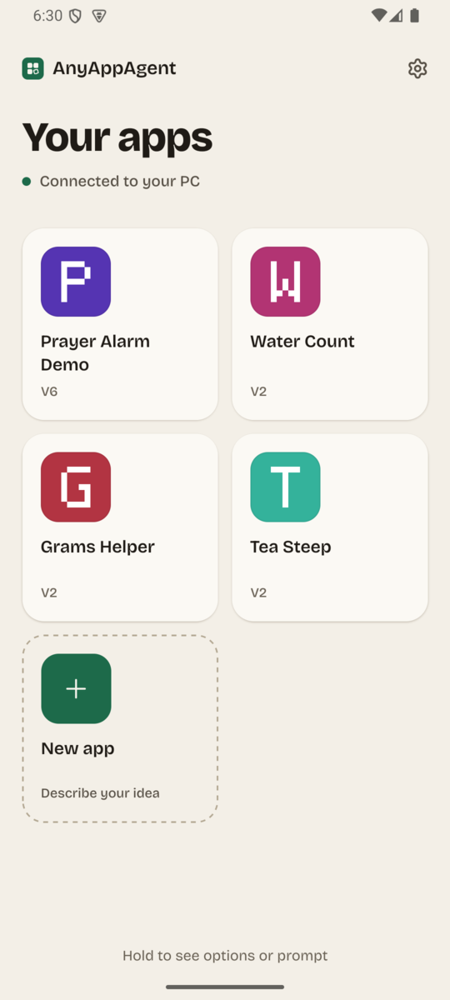
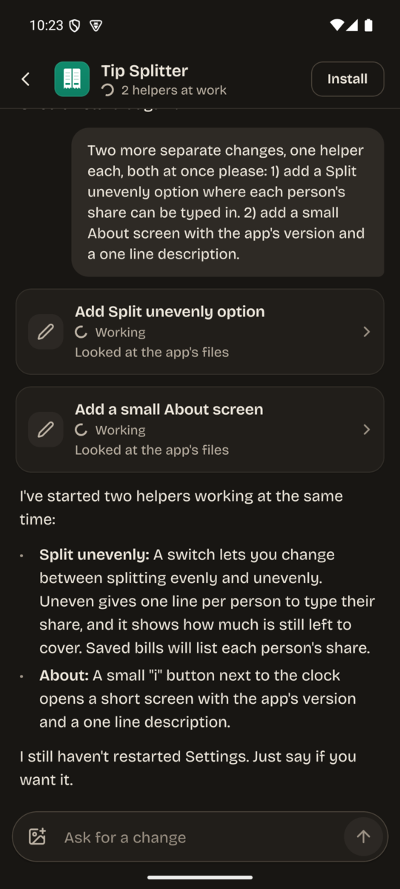
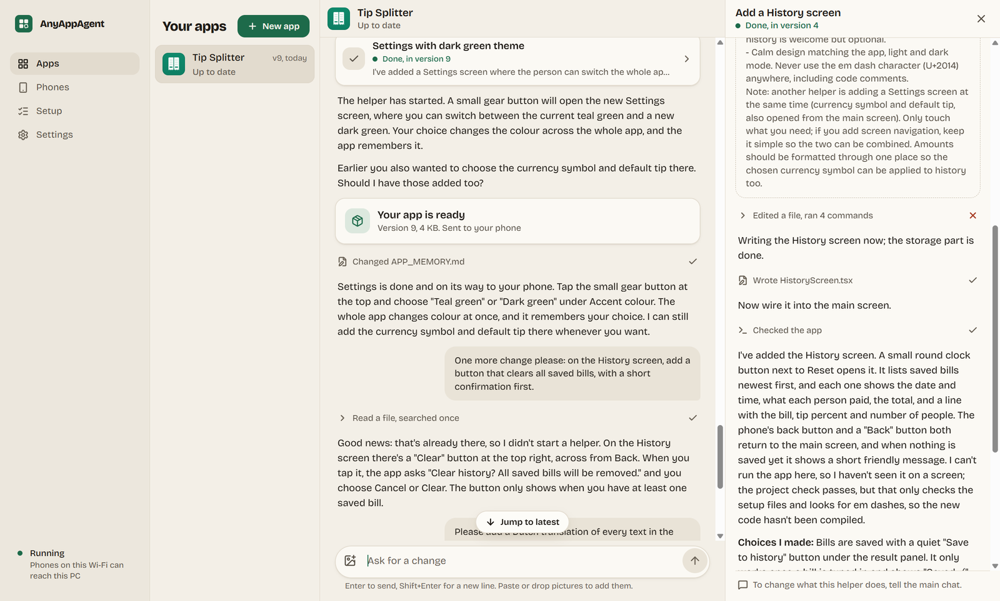
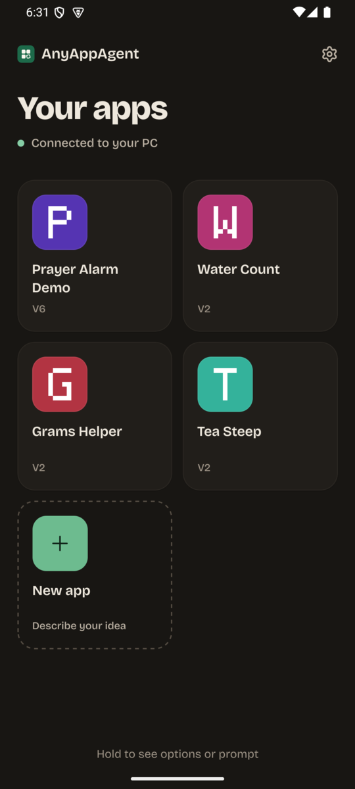
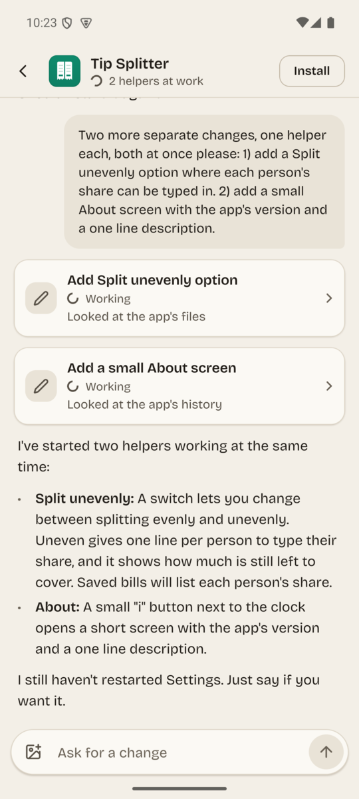
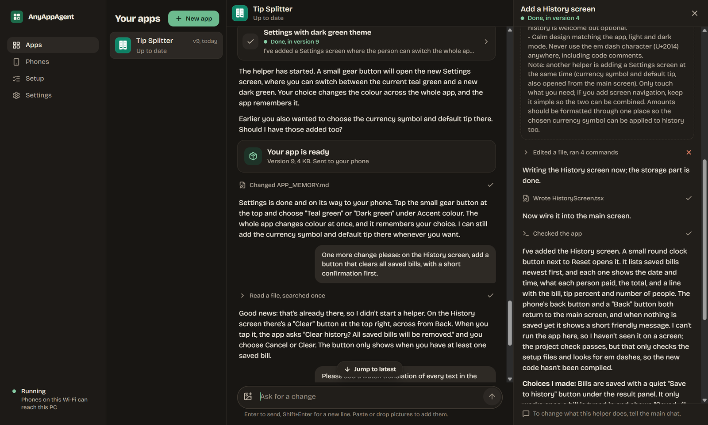
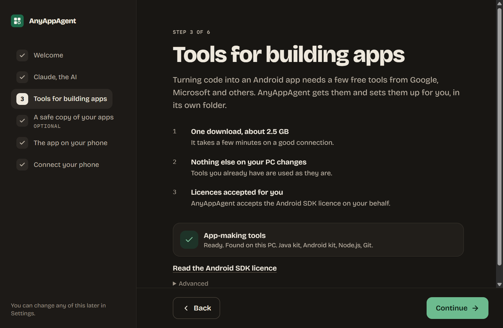

# AnyAppAgent

**Make your own Android apps from your phone.** You describe the app you want in plain words. An
AI agent on your PC (Claude Code) writes it, your PC builds it, and the finished app installs
itself on your phone. Ask for a change, and the new version installs over the old one.

<p align="center">
  
  
  
</p>

## Download

| Where | File | |
| --- | --- | --- |
| **Phone** (Android 7 or newer) | [AnyAppAgent.apk](https://github.com/maddada/AnyAppAgent/releases/latest/download/AnyAppAgent.apk) | For nearly every phone (64-bit ARM). |
| Phone, other devices | [AnyAppAgent-universal.apk](https://github.com/maddada/AnyAppAgent/releases/latest/download/AnyAppAgent-universal.apk) | Also runs on x86_64 devices such as the Android emulator and some tablets. Bigger. |
| **PC** (Windows 10 or 11, 64-bit) | [AnyAppAgent-Setup.exe](https://github.com/maddada/AnyAppAgent/releases/latest/download/AnyAppAgent-Setup.exe) | The desktop app. It sets up everything else for you. |

All releases and what changed in each: [Releases](https://github.com/maddada/AnyAppAgent/releases).
AnyAppAgent is not in the Play Store and never will be: you install it yourself (see
[Installing on Android](#installing-on-android-sideloading) below).

## What it is for

Most people have ideas for small apps that would make their own day easier: a prayer alarm with
the exact reminders they want, a water counter, a tip splitter for their friends. Making one
normally means a PC, a code editor and a lot of know-how. AnyAppAgent's goals:

- **Make apps from the phone.** You type (or send a picture of) what you want; you never open a
  code editor, a terminal or a file.
- **Simple for people who are not technical.** The PC part is one desktop app with a guided setup
  that checks each thing by itself and fixes what it can with one click. Optional steps can be
  skipped.
- **Your apps, on your devices.** Everything is built on your own PC. Each app is a normal Android
  app on your phone, and its code is yours (optionally kept in your own private GitHub repository).
- **Always working.** After every change the PC builds the app. If the build fails, the agent
  fixes it before you see anything; you only get versions that install.

## How it works

<p align="center">
  
</p>

1. **On your PC**, the desktop app runs the companion: a small server that talks to your phone.
   For each of your apps it keeps one Claude Code session, working in that app's own folder.
   That session is the only thing you talk to for that app. It answers in short, plain language,
   remembers what the app is for, and can start helpers for bigger changes (you see them in the
   chat as "2 helpers at work").
2. **On your phone**, AnyAppAgent shows your apps in a grid. Tap an app to open it, hold it for
   its options, or open its chat to ask for a change. "New app" asks only for a name and what it
   should do.
3. **When the agent finishes**, the PC builds the APK (the Android app file), saves the change,
   and sends the new version to your phone. AnyAppAgent downloads it in the background and
   starts the install, which replaces the version that was there.
4. **Easy Connect**: scan one QR code and your phone reaches your PC from anywhere, not only on
   the same Wi-Fi, with nothing else to install. On the same Wi-Fi you can also connect with the
   PC's address and a 6-digit code.

More you get:

- **AI for your apps**: put one Claude or OpenRouter key in AnyAppAgent's Settings, and every app
  it made can use AI (chat, pictures, tools) through it. The key never leaves AnyAppAgent; you
  can switch each app off and see how much each one used.
- **Pictures in the chat**: send a screenshot or a photo to show what you mean.
- **Follow along on the PC**: the same chats are in the desktop app, with every step the agent
  took.
- **Light and dark**, on the phone and on the PC.

<p align="center">
  
  
</p>
<p align="center">
  
</p>

## What you need

- **A Windows PC** (Windows 10 or 11, 64-bit) that is switched on while you make apps. About
  2.5 GB of free tools are downloaded during setup (Java, the Android tools, Node.js, Git), into
  AnyAppAgent's own folder; tools you already have are used as they are.
- **A Claude account with a paid plan** (Pro or Max). You sign in once in the browser during
  setup. The free plan cannot write apps.
- **An Android phone** with Android 7 or newer.
- Optional: **a GitHub account**, so every app also has a safe copy in its own private
  repository. Setup signs you in if you want it.

## Getting started

1. **On your PC**: download and run
   [AnyAppAgent-Setup.exe](https://github.com/maddada/AnyAppAgent/releases/latest/download/AnyAppAgent-Setup.exe).
   The installer is not code signed yet, so Windows SmartScreen may say "Windows protected your
   PC": choose **More info**, then **Run anyway**. AnyAppAgent opens by itself when it is
   installed.
2. **Follow the setup** in the desktop app: sign in to Claude, let it get the building tools, and
   optionally connect GitHub.
3. **On your phone**: scan the download QR code the desktop app shows, or open
   [AnyAppAgent.apk](https://github.com/maddada/AnyAppAgent/releases/latest/download/AnyAppAgent.apk)
   in the phone's browser, and install it (next section).
4. **Connect**: in the desktop app choose **Connect a phone**, and scan its code with
   AnyAppAgent on the phone.
5. **Tap New app**, give it a name, say what it should do, and wait for it to arrive.

<p align="center">
  
</p>

## Installing on Android (sideloading)

Apps that do not come from the Play Store are "unknown apps" to Android. Installing one yourself
is called sideloading. Android lets you do it, but asks you once to allow the app you install
from (your browser or your Files app). AnyAppAgent then asks for the same permission once, so it
can install the apps it makes for you.

### Step by step

1. **Download** [AnyAppAgent.apk](https://github.com/maddada/AnyAppAgent/releases/latest/download/AnyAppAgent.apk)
   on your phone (or scan the QR code in the desktop app). If the browser warns that "this type
   of file can harm your device", choose **Download anyway**.
2. **Open the file**: tap the finished download in the browser or in its notification, or open
   your **Files** app (Samsung: **My Files**), go to **Downloads** and tap `AnyAppAgent.apk`.
3. Android says something like "For your security, your phone is not allowed to install unknown
   apps from this source". Tap **Settings**, turn on **Allow from this source**, then go back.
4. Tap **Install**.
5. If **Google Play Protect** shows a message (see below), choose to install anyway.
6. Tap **Open**. The first time AnyAppAgent installs one of your apps, Android asks the same
   question for AnyAppAgent itself: allow it in the same way.

### What the Play Protect warning means

Play Protect checks apps against what Google has seen in the Play Store. AnyAppAgent and the apps
it makes are not in the Play Store, so Google does not know their developer yet, and Play Protect
may say "App blocked to protect your device", "Unsafe app blocked" or "Play Protect doesn't
recognise this app". That means unknown, not that a virus was found. To continue:

- Tap **More details** (or the small arrow), then **Install anyway**.
- If it offers to **send the app for scanning**, you can choose either; sending is not needed to
  install.

Only install AnyAppAgent from this page's links. Apps it makes for you come from your own PC.

### Where the setting lives

If you missed the prompt, or want to switch it off again later, the setting is in Android's
Settings. The exact names move a little between versions; **searching Settings for "unknown"**
always finds it.

| Phone | Where |
| --- | --- |
| **Samsung** (One UI) | Settings, **Apps**, the menu (three dots) top right, **Special access**, **Install unknown apps**, then your browser (Chrome or Samsung Internet) or **My Files**, and **Allow from this source**. On newer Samsung phones, also check Settings, **Security and privacy**, **Auto Blocker**: while it is on, it blocks apps from outside the stores. Switch it off to install, and back on afterwards if you like (AnyAppAgent's own installs need it off too). |
| **Google Pixel** | Settings, **Apps**, **Special app access**, **Install unknown apps**, then **Chrome** or **Files**, and **Allow from this source**. |
| **Xiaomi, Redmi, POCO** (HyperOS, MIUI) | Settings, **Privacy protection** (on some versions **Apps**, then **Manage apps**), **Special permissions**, **Install unknown apps**, then your browser or **File Manager**, and **Allow from this source**. Xiaomi may also scan the app and show a countdown before **Continue installation**, or ask you to sign in to a Mi account: you can wait for the countdown and continue. |

For AnyAppAgent itself the entry is called **AnyAppAgent** in the same list.

### Updating AnyAppAgent

Download the newest `AnyAppAgent.apk` and install it the same way: it installs over the one you
have and keeps your apps, your connection and your AI key.

**Coming from version 0.1.0?** From 0.2.0 on, AnyAppAgent is signed with its own release key
instead of a shared development key, so Android will not install 0.2.0 over 0.1.0 ("App not
installed" or "conflicts with an existing package"). Uninstall the old AnyAppAgent first (hold its
icon, **Uninstall**), then install 0.2.0. The apps you made stay on your phone and on your PC. You
connect the phone to your PC again (Connect a phone, scan the code), and if you used AI for your
apps, you put your AI key in Settings again. An app made before that says AI is not set up
starts working again as soon as AnyAppAgent installs a new version of it (ask it for any small
change). After that, AnyAppAgent updates install in place again.

## For developers

AnyAppAgent is TypeScript end to end: an Expo (React Native) phone app, an Electron desktop app,
and a Node companion that runs Claude Code over the Agent Client Protocol.

| Folder | What |
| --- | --- |
| `app/` | The Android app (Expo, React Native) and its native modules (installing, Easy Connect, the AI proxy). |
| `desktop/` | The Windows desktop app (Electron): setup, runs the companion, chats, phones. |
| `server/` | The companion: pairing, one Claude Code session per app, builds, Git and GitHub. |
| `builder/` | Creates an app from a template and builds its signed APK. |
| `template/`, `template-kotlin/`, `template-exact/` | The starters new apps are copied from (React Native, native Kotlin, Expo Exact). |
| `shared/` | The protocol between phone, PC and desktop, the shared chat core, the theme. |

Start with [`AGENTS.md`](AGENTS.md), [`docs/SPEC.md`](docs/SPEC.md) (what is built and the
decisions made) and [`docs/ENVIRONMENT.md`](docs/ENVIRONMENT.md) (the Android toolchain). How a
release is built and signed: [`docs/RELEASING.md`](docs/RELEASING.md).

Each folder has its own `package.json`. The usual checks:

```
cd server   && npm ci && npm run typecheck && npm test
cd desktop  && npm ci && npm run typecheck && npm test
cd app      && npm ci && npm run typecheck && npm run lint
cd builder  && npm test
cd shared/chat && npm test
```

## License

[MIT](LICENSE). The fonts in `shared/theme/fonts` are under the SIL Open Font License, and the
Lucide icons under their own license (see the files next to them). Third-party code and its
notices: `THIRD_PARTY_NOTICES.md` in each folder that has one.
